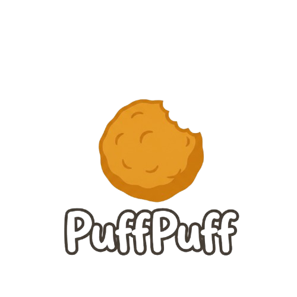

<p align="center"></p>

# PuffPuff

PuffPuff is a high-performance, lightweight multimedia engine replacement for Lime – targeting the HashLink (ash / hl / hl/c) runtime.

## Install

```
haxelib install puffpuff
```

Add `-lib puffpuff` to your build and compile for HashLink. Run the bytecode with HashLink (1.15) or with [Ash](https://github.com/rayzor-blade/ash). HashLink has no JIT virtual machine on ARM processors (Apple silicon, Linux aarch64), so use Ash there. For HashLink, also add `-D ash_future_stock` to the build, and make the folder with the `.hl` file visible to the library loader (on Linux, `LD_LIBRARY_PATH=. hl app.hl`). Haxelib installs the other libraries it needs (`hlwgpu`, `hlwindow`, `hlavi`, `ash-future`, `ash-simd`, `hashlink`). It also bundles `blinc_abi`, which does text shaping, and the build copies it next to the `.hl` file.

PuffPuff is tested on macOS (Apple silicon) and Linux (x86_64, Intel graphics). The bundled `blinc_abi` also covers Linux aarch64, macOS x86_64 and Windows, which are untested.

## Use with OpenFL and HaxeFlixel

PuffPuff replaces Lime's backend and renders with WebGPU. OpenFL support is on the `wgpu` branch of OpenFL, behind the `openfl_wgpu` define, and HaxeFlixel needs a small matching change. Build both with `-D openfl_wgpu`.

## Build options

| Option | Effect |
| --- | --- |
| `-D puffpuff_no_default_font` | Don't bundle the default Arimo fonts. |
| `-D puffpuff_no_hdll` | Don't warn when `blinc_abi.hdll` isn't found. You supply it. |
| `-D puffpuff_http` | Allow remote URLs in `HTTPRequest`. This needs HashLink's `ssl` library at load time. |
| `PUFFPUFF_NATIVE_DIR` | Environment variable. A directory with a `blinc_abi.hdll` to use instead of the bundled one. |

## Testing without a window

`tools/snapshot/run.sh Scene.hx` renders a scene offscreen and writes a PNG to `.puffpuff/snapshots`. Most scenes in `tools/snapshot/scenes` check pixels, so they double as tests. On Linux this still needs a running display server (Wayland or X).

## Benchmarks

How PuffPuff is measured, how it compares with OpenFL's native text path, and how to reproduce it: [docs/benchmarks](docs/benchmarks/README.md).

## Attribution & License

PuffPuff is licensed under the [MIT License](LICENSE).
The `lime.*` compatibility layer implements the [Lime](https://github.com/openfl/lime) API surface (`Copyright (c) OpenFL Contributors`, MIT License) backed by `hlwindow` (`xwindow`), `hlwgpu` (`xgpu`), `hlavi` (`xavi`), `ash-future`, `ash-simd`, and `blinc_abi`.

