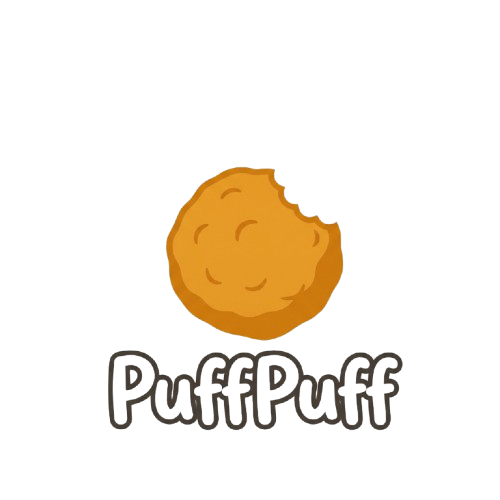

# PuffPuff

PuffPuff is a high-performance, lightweight multimedia engine replacement for Lime – targeting the HashLink (ash / hl / hl/c) runtime.

## Attribution & License

PuffPuff is licensed under the [MIT License](LICENSE).
The `lime.*` compatibility layer implements the [Lime](https://github.com/openfl/lime) API surface (`Copyright (c) OpenFL Contributors`, MIT License) backed by `hlwindow` (`xwindow`), `hlwgpu` (`xgpu`), `hlavi` (`xavi`), `ash-future`, `ash-simd`, and `blinc_abi`.

